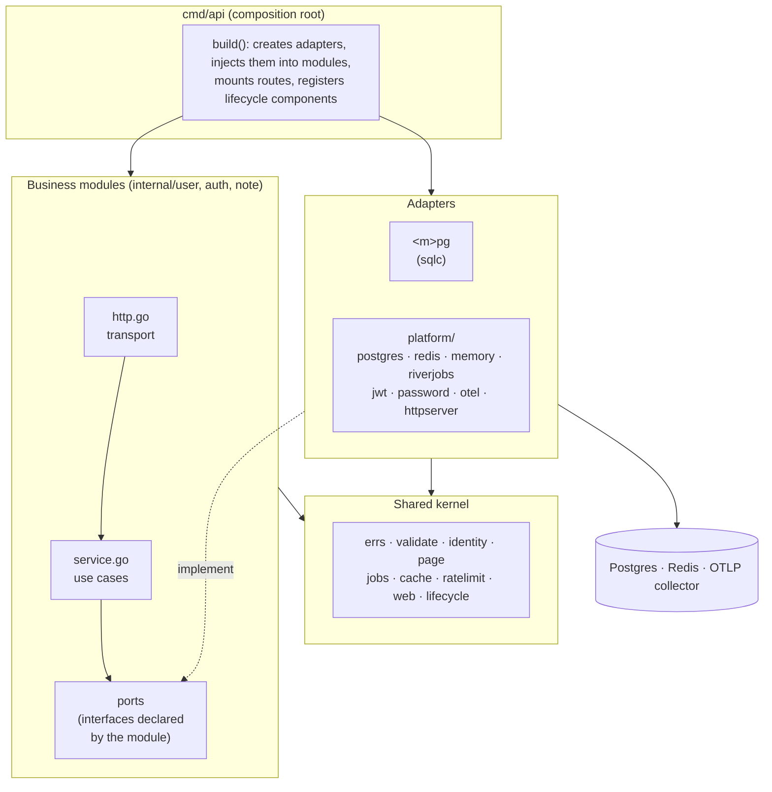
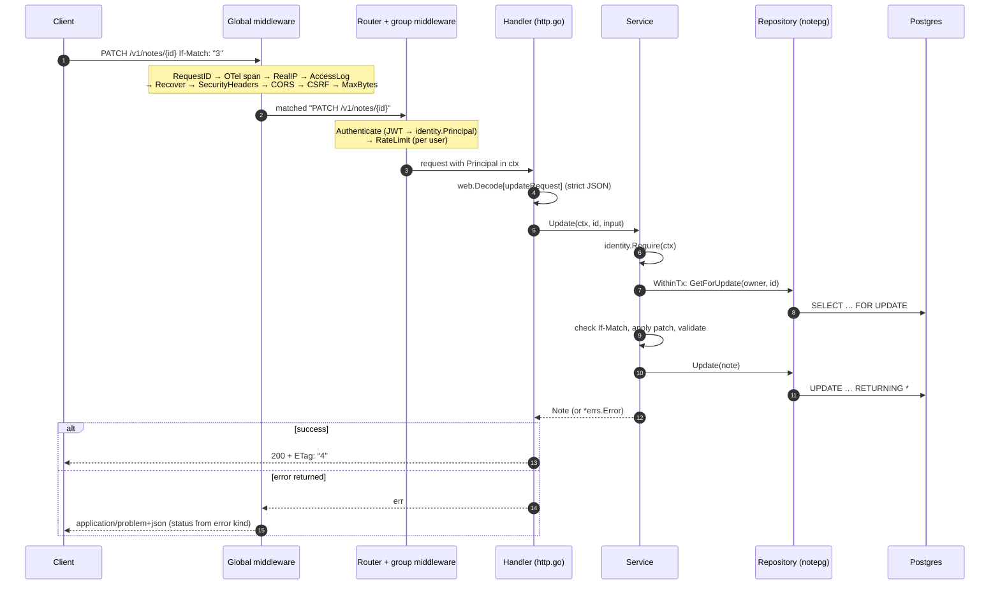
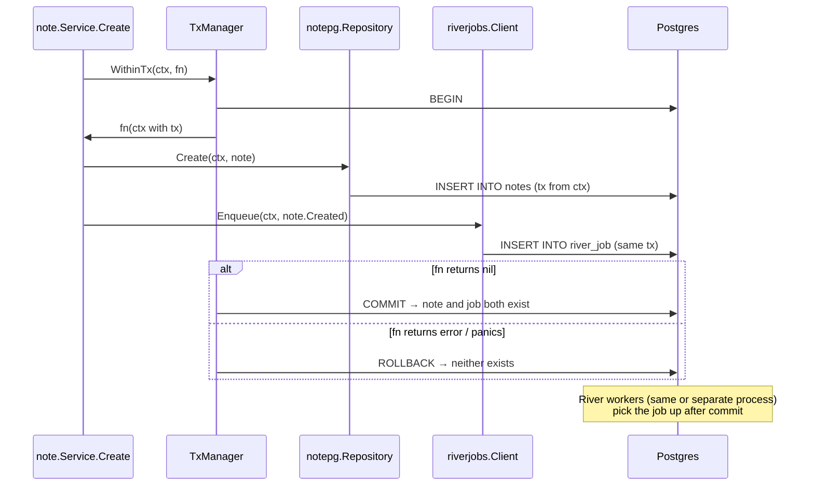
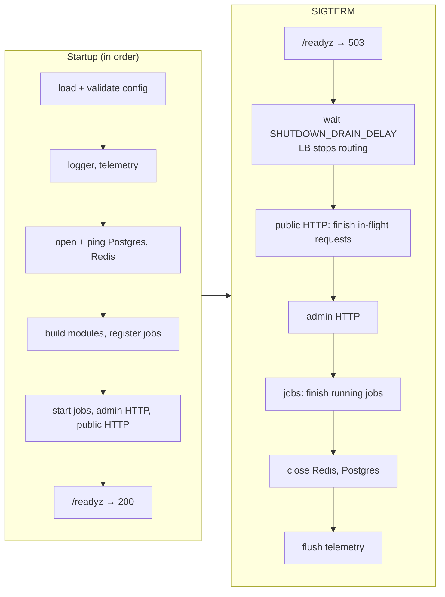

# goplate

A production-shaped Go backend boilerplate. Fork it, delete the example
module, and start writing business logic on day one: auth, persistence,
background jobs, caching, rate limiting, observability, graceful shutdown and
an API contract are already done, tested and documented.

The guiding rule: **every component is replaceable.** Business code depends on
small interfaces (ports) that it declares itself; infrastructure
(Postgres, Redis, River, OpenTelemetry) plugs in from one composition root.
Swapping Redis for Valkey, River for a broker, or JWT for an external IdP
touches one adapter and a few wiring lines, never a service.

Every significant choice, with the alternatives that were rejected, is
recorded in [`docs/adr`](docs/adr/README.md).

---

## Contents

- [Quick start](#quick-start)
- [Project layout](#project-layout)
- [Architecture](#architecture)
- [What happens on a request](#what-happens-on-a-request)
- [Components and how to replace them](#components-and-how-to-replace-them)
- [Authentication](#authentication)
- [Transactions and background jobs](#transactions-and-background-jobs)
- [Startup and graceful shutdown](#startup-and-graceful-shutdown)
- [Errors](#errors)
- [Observability](#observability)
- [Configuration](#configuration)
- [Testing](#testing)
- [Adding and removing features](#adding-and-removing-features)
- [Deploying](#deploying)
- [License](#license)

---

## Quick start

Requirements: Go 1.26+ (an older `go` downloads the right toolchain
automatically) and Docker.

```bash
cp .env.example .env     # local configuration (gitignored)
make up                  # Postgres, Redis, Jaeger, Prometheus
make migrate             # apply schema migrations
make seed                # admin@example.com / see SEED_ADMIN_PASSWORD in .env
make run                 # API on :8080, admin/metrics on :9090
```

Then:

```bash
open http://localhost:8080/docs                         # interactive API reference
curl -s localhost:8080/v1/users -H 'Content-Type: application/json' \
  -d '{"email":"ada@example.com","name":"Ada","password":"correct horse battery"}'
curl -s localhost:8080/v1/auth/login -H 'Content-Type: application/json' \
  -d '{"email":"ada@example.com","password":"correct horse battery","token_delivery":"body"}'
```

| URL                                | What                                  |
| ---------------------------------- | ------------------------------------- |
| http://localhost:8080/docs         | API reference (OpenAPI)               |
| http://localhost:9090/metrics      | Prometheus metrics                    |
| http://localhost:9090/readyz       | Readiness with per-dependency detail  |
| http://localhost:16686             | Jaeger traces                         |
| http://localhost:9091              | Prometheus UI                         |

`make help` lists every task.

---

## Project layout

```
cmd/
  api/                  composition root: the only place that knows every concrete type
    main.go             signals → run()
    app.go              build(): config → adapters → modules → lifecycle (read this first)
    http.go             middleware stack and route groups
    adapters.go         bridges between modules (auth ← user)
  admin/                migrate up|down|status|create, seed
api/                    openapi.yaml (the contract) + docs handler
migrations/             SQL migrations (goose), also sqlc's schema source
internal/
  user/  auth/  note/   ── business modules ──────────────────────────────
    <m>.go              domain types, errors, and the PORTS the module needs
    service.go          use cases: validation, authorization, business rules
    http.go             transport: routes, DTOs, mapping (no business logic)
    module.go           Deps + NewModule: the module's public face
    <m>pg/              Postgres adapter (sqlc-generated code stays in here)
  errs/ validate/ identity/ page/ jobs/ cache/ ratelimit/   ── shared kernel ──
  web/                  HTTP toolkit on net/http: router, errors, middleware
  lifecycle/            start/stop orchestration, health probes
  config/               typed env configuration (cmd/* only)
  platform/             ── infrastructure adapters ─────────────────────────
    postgres/           pool + context-carried transactions
    redis/  memory/     cache.Store and ratelimit.Limiter implementations
    riverjobs/          job queue (River) implementing JobEnqueuer
    jwt/  password/     token signer, argon2id hasher
    otel/  logging/     telemetry setup, context-aware slog
    httpserver/  migrate/
  testutil/             containers for integration tests
docs/
  adr/                  architecture decision records
  adding-a-module.md
```

---

## Architecture

goplate is a **modular monolith** (ADR-0002). Dependencies point inwards:
modules know only their own ports and the small shared kernel. Adapters
implement ports. The composition root connects them.



The rules, enforced by `depguard` in `make lint` (see `.golangci.yml`):

| Package                       | May import                               | Must not import                                  |
| ----------------------------- | ---------------------------------------- | ------------------------------------------------ |
| module core (`internal/note`) | kernel, stdlib, uuid                     | `platform/*`, `config`, drivers, other modules   |
| module adapter (`notepg`)     | its module, `platform/postgres`, kernel  | other modules                                    |
| `internal/platform/*`         | drivers/SDKs, kernel                     | modules, `config`                                |
| kernel                        | stdlib, small libraries                  | modules, `platform/*`, `config`                  |
| `cmd/*`                       | everything                               | n/a                                              |

Three conventions make components replaceable:

1. **The consumer defines the interface**, listing only what it calls.
   `auth` needs to find users, so `auth` declares `UserFinder`; the user
   module never knows. [`cmd/api/adapters.go`](cmd/api/adapters.go) bridges
   them. If users moved to a separate service, only that bridge changes.
2. **Constructors return concrete types.** The caller decides what to abstract.
3. **Modules get their own config struct**, never the global `Config`.

---

## What happens on a request



Handlers stay thin (decode → call service → encode). Services own
validation and authorization, so they stay correct when called from a job or
a CLI instead of HTTP.

---

## Components and how to replace them

| Component         | Port (where declared)                         | Default adapter                       | To replace it                                                      |
| ----------------- | --------------------------------------------- | ------------------------------------- | ------------------------------------------------------------------ |
| HTTP router       | `web.Router` (`internal/web`)                 | `net/http.ServeMux`                   | Edit `internal/web/router.go` only (ADR-0003)                      |
| Persistence       | `note.Repository`, `user.Repository`, …       | sqlc + pgx in `<m>pg/`                | Write a new adapter; change one line in `cmd/api/app.go` (ADR-0004) |
| Transactions      | `note.Transactor`, `auth.Transactor`          | `platform/postgres.TxManager`         | Same                                                               |
| Cache             | `cache.Store` (`internal/cache`)              | Redis, or in-memory (`CACHE_DRIVER`)  | Implement `Get/Set/Delete` (ADR-0009)                              |
| Rate limiting     | `ratelimit.Limiter`                           | Redis GCRA, or in-memory              | Implement `Allow` (ADR-0013)                                       |
| Background jobs   | `note.JobEnqueuer` + `jobs.Handler[T]`        | River (`platform/riverjobs`)          | Implement `Enqueue`; register handlers in your queue (ADR-0010)    |
| Access tokens     | `auth.TokenIssuer`                            | JWT HS256 / EdDSA (`platform/jwt`)    | e.g. PASETO, or verify an external IdP's tokens (ADR-0007)         |
| Password hashing  | `auth.PasswordHasher`, `user.PasswordHasher`  | argon2id (`platform/password`)        | Implement `Hash/Compare`                                           |
| Sessions          | `auth.SessionStore`                           | Postgres (`authpg`)                   | e.g. a Redis adapter                                               |
| Token revocation  | `auth.Denylist` (optional)                    | any `cache.Store`                     | `AUTH_DENYLIST_ENABLED=true`                                       |
| Telemetry         | OpenTelemetry API                             | OTLP traces, Prometheus metrics       | Environment variables only (ADR-0011)                              |
| Logging           | `*slog.Logger`                                | JSON/text with trace and request IDs  | Any `slog.Handler`                                                 |
| Config            | `config.Load(map)`                            | env vars via caarlos0/env             | Change `internal/config` only (ADR-0016)                           |

---

## Authentication

Short-lived JWT access tokens plus opaque refresh tokens that rotate on every
use (ADR-0007). Browsers get HttpOnly cookies; other clients use
`Authorization: Bearer` (ADR-0008).

```mermaid
sequenceDiagram
    autonumber
    participant C as Client
    participant A as auth.Service
    participant DB as auth_sessions

    C->>A: POST /v1/auth/login {email, password}
    A->>A: argon2id compare (dummy compare if email unknown)
    A->>DB: INSERT session {family F, hash(R1)}
    A-->>C: access JWT (15m) + refresh R1 (30d)

    Note over C,A: …access token expires…

    C->>A: POST /v1/auth/refresh R1
    A->>DB: SELECT … WHERE hash = hash(R1) FOR UPDATE
    A->>DB: mark R1 used; INSERT {family F, hash(R2)}
    A-->>C: new access JWT + R2

    Note over C,A: an attacker replays the stolen R1
    C->>A: POST /v1/auth/refresh R1
    A->>DB: R1 already used ⇒ revoke the whole family F
    A-->>C: 401 (R2 is now dead too; the real user must log in again)
```

- Only `sha256(refresh token)` is stored, so a database leak doesn't expose
  usable tokens.
- Verification pins the algorithm and requires `iss`, `aud` and `exp`.
- Logout revokes the session family; logout-all revokes every family. With
  `AUTH_DENYLIST_ENABLED`, the current access token is rejected immediately
  too, instead of when it expires (at most 15 minutes later).
- Cookie mode: `__Host-`/`__Secure-` prefixed, `HttpOnly`, `Secure`,
  `SameSite=Lax`. The refresh cookie is scoped to `/v1/auth/refresh`. CSRF
  is blocked by Go's `http.CrossOriginProtection` (ADR-0020).
- Login is rate limited per IP and per email. Errors never reveal whether an
  email exists.

---

## Transactions and background jobs

Services get atomicity without importing pgx: the transaction travels in
`context`, and every repository (and the job queue) joins it (ADR-0004,
ADR-0010).



This removes the classic dual-write bug ("row saved, job lost"), with no
outbox table. Jobs are delivered **at least once**, so handlers must be
idempotent. One binary can run as API only, worker only, or both
(`JOBS_WORKER_ENABLED`).

---

## Startup and graceful shutdown

Every long-running part is a `lifecycle.Component` (ADR-0012). They start in
registration order and stop in reverse, so dependencies outlive their users.



- `/livez` never checks dependencies, so a database blip doesn't restart
  every pod. `/readyz` checks them all, in parallel, with timeouts and a 1s
  cache.
- The whole shutdown is bounded by `SHUTDOWN_TIMEOUT` (keep it below the
  orchestrator's grace period, 30s in Kubernetes).
- Servers always have read, write, idle and header timeouts.

---

## Errors

Services return `*errs.Error` values that carry a **kind**
(`NotFound`, `Conflict`, `Invalid`, …), never an HTTP status (ADR-0018). One
table in `internal/web` maps kinds to statuses and renders RFC 9457 problems:

```json
{
  "type": "/problems/invalid",
  "title": "Bad Request",
  "status": 400,
  "detail": "the request contains invalid fields",
  "instance": "/v1/notes",
  "request_id": "6ZJ4N2Q…",
  "errors": [{ "field": "title", "message": "is required" }]
}
```

5xx responses never include internal details; those go to the logs and
traces, correlated by `request_id`. Panics become logged 500s.

```go
var ErrNotFound = errs.New(errs.NotFound, "note not found") // declare
return note.Note{}, ErrNotFound                              // return from service/adapter
```

---

## Observability

- **Logs**: `*slog.Logger`, JSON in production. Every record logged with a
  context carries `trace_id`, `span_id` and `request_id`. The linter enforces
  `InfoContext(ctx, …)` when a context is in scope.
- **Traces**: OpenTelemetry. HTTP spans are named by route pattern, with
  child spans for every SQL query (otelpgx) and Redis command. Incoming
  `traceparent` headers are continued.
- **Metrics**: Prometheus on the admin port. Includes HTTP latency and status
  by route, pool statistics, cache hit/miss, and Go runtime metrics.
- Configure exporters with the standard `OTEL_*` variables.
  `OTEL_TRACES_EXPORTER=none` disables tracing.

---

## Configuration

Environment variables only, parsed into typed structs and validated at
startup (ADR-0016). Every problem is reported at once.
[`.env.example`](.env.example) documents every variable; defaults are
production-safe (docs off, `Secure` cookies, JSON logs). Secrets use
`config.Secret`, which prints `REDACTED` in logs, JSON and `fmt` output.

---

## Testing

```bash
make test               # unit tests, -race, no Docker needed
make test-integration   # + real Postgres/Redis via testcontainers
make lint               # golangci-lint incl. architecture rules
make check              # all of the above + stale-sqlc check
```

| Layer             | How                                                                 | Example                                         |
| ----------------- | ------------------------------------------------------------------- | ----------------------------------------------- |
| Services          | hand-written fakes of the module's own ports                        | `internal/auth/service_test.go`                 |
| HTTP toolkit      | `httptest`                                                          | `internal/web/web_test.go`                      |
| Repositories      | real Postgres in a container, one user per test for isolation       | `internal/note/notepg/repository_integration_test.go` |
| Transactions/jobs | proves enqueue-in-tx commits/rolls back with the data               | `internal/platform/riverjobs/…_integration_test.go`   |
| Whole app         | boots `build()` against containers and drives it over HTTP          | `cmd/api/e2e_integration_test.go`               |
| API contract      | every route documented, every documented route exists               | `cmd/api/openapi_test.go`                       |

---

## Adding and removing features

- **Add a module**: follow [`docs/adding-a-module.md`](docs/adding-a-module.md);
  `internal/note` is the reference to copy.
- **Remove the example module**: delete `internal/note`, its migration, its
  block in `sqlc.yaml`, its paths in `api/openapi.yaml`, and the
  `notes` lines in `cmd/api/app.go` and `cmd/api/http.go`.
- **Run without Redis**: `CACHE_DRIVER=memory RATELIMIT_DRIVER=memory` and
  leave `AUTH_DENYLIST_ENABLED=false`. Only valid for a single instance.
- **Bearer-only or cookie-only auth**: `AUTH_COOKIE_ENABLED=false` or
  `AUTH_BEARER_ENABLED=false`.
- **Separate workers**: run the same image twice, with
  `JOBS_WORKER_ENABLED=false` (API) and a worker deployment that doesn't
  receive traffic.

---

## Deploying

The image (`make docker-build`) is distroless, non-root, and contains both
binaries.

1. Run migrations as a **separate step** before rolling out (a Kubernetes Job
   or init container): `/app/admin migrate up`. It takes an advisory lock and
   exits non-zero on failure. Keep migrations backwards compatible with the
   previous release (expand/contract), because old pods keep serving during a
   rolling deploy.
2. Probes: liveness `GET :8080/livez`, readiness `GET :8080/readyz`.
3. Set `SHUTDOWN_DRAIN_DELAY=5s`, `SHUTDOWN_TIMEOUT=20s`, and
   `terminationGracePeriodSeconds: 30`.
4. Keep `:9090` (metrics, pprof, detailed readiness) on the internal network
   only.
5. Set `HTTP_TRUSTED_PROXIES` to your load balancer's CIDRs, or rate limits
   will key on the proxy's IP.

---

## License

[MIT](LICENSE). Projects started from goplate may use any license they like;
keep the copyright notice in copies of goplate itself.
