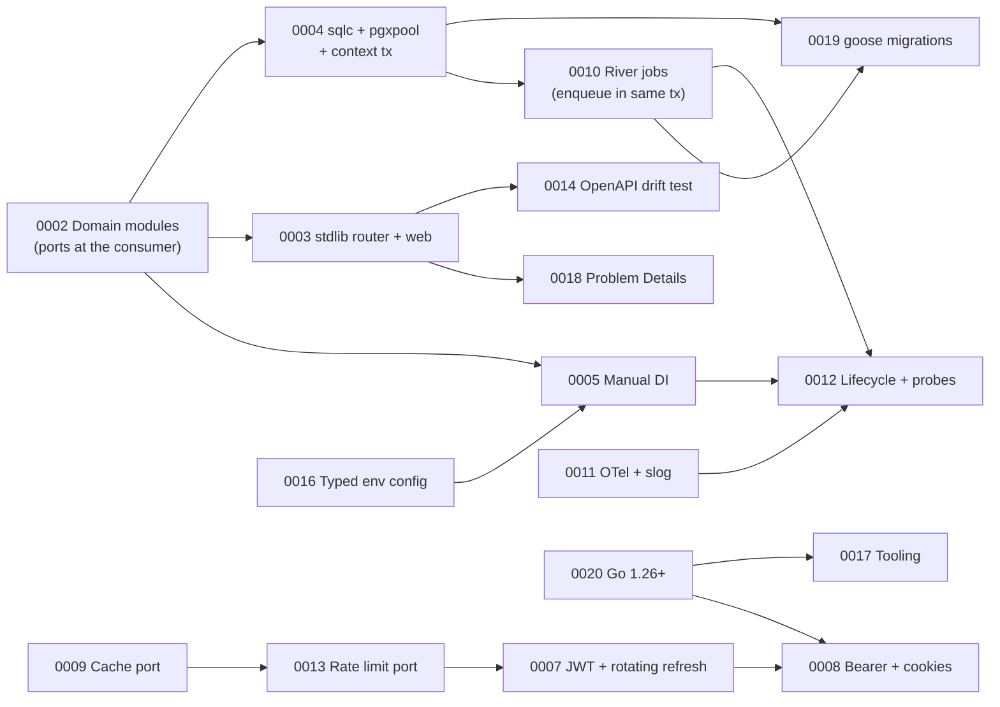

# Architecture Decision Records

This folder records **why** goplate is built the way it is: for each
significant choice, the alternatives we weighed and the reasons we picked one.
See [ADR-0001](0001-record-architecture-decisions.md) for the rules and
[template.md](template.md) to write a new one.

**Status meanings**

- **Accepted**: decided; change it only by writing a superseding ADR.
- **Proposed**: an author default that still needs sign-off; can be edited
  freely until accepted.

## Index

| #    | Decision                                                                                                  | Status   | Tags |
| ---- | --------------------------------------------------------------------------------------------------------- | -------- | ---- |
| 0001 | [Record architecture decisions as ADRs](0001-record-architecture-decisions.md)                            | Accepted | process |
| 0002 | [Modular monolith of domain modules](0002-modular-monolith-with-domain-modules.md)                        | Accepted | architecture |
| 0003 | [stdlib router behind a thin internal `web` package](0003-stdlib-http-router-with-internal-web-package.md) | Accepted | http |
| 0004 | [sqlc + pgxpool, module repositories, context-carried transactions](0004-sqlc-pgxpool-repositories-and-context-transactions.md) | Accepted | data |
| 0005 | [Manual dependency injection in one composition root](0005-manual-dependency-injection.md)                | Accepted | architecture |
| 0006 | [Boilerplate feature scope](0006-boilerplate-feature-scope.md)                                            | Accepted | scope |
| 0007 | [JWT access + rotating opaque refresh tokens](0007-authentication-jwt-access-and-rotating-refresh-tokens.md) | Accepted | security |
| 0008 | [Tokens via Bearer header and HttpOnly cookies](0008-token-transport-bearer-and-cookies.md)               | Accepted | security |
| 0009 | [Cache port with Redis and in-memory adapters](0009-cache-port-with-redis-and-in-memory-adapters.md)      | Accepted | data |
| 0010 | [Background jobs on Postgres with River](0010-background-jobs-with-river.md)                              | Accepted | async |
| 0011 | [OpenTelemetry, Prometheus and `slog`](0011-observability-opentelemetry-prometheus-slog.md)               | Accepted | ops |
| 0012 | [Component lifecycle, health probes, graceful shutdown](0012-component-lifecycle-and-health-probes.md)    | Accepted | ops |
| 0013 | [Rate limiting port with memory and Redis adapters](0013-rate-limiting-port-with-memory-and-redis-adapters.md) | Accepted | security |
| 0014 | [Spec-first OpenAPI with a route-drift test](0014-openapi-spec-first-documentation.md)                    | Accepted | api |
| 0015 | [Example domain: users/auth + notes](0015-example-domain-users-and-notes.md)                              | Accepted | scope |
| 0016 | [Environment config into typed, validated structs](0016-configuration-from-environment-into-typed-structs.md) | Accepted | config |
| 0017 | [Docker Compose, Makefile, golangci-lint, integration tests](0017-developer-tooling-and-testing.md)       | Accepted | tooling |
| 0018 | [Domain error kinds rendered as RFC 9457 problems](0018-error-model-and-rfc9457-problem-details.md)       | Accepted | api |
| 0019 | [Migrations with goose via an admin command](0019-database-migrations-with-goose.md)                      | Accepted | data |
| 0020 | [Target a supported Go release (1.26 min, 1.27 toolchain)](0020-target-a-supported-go-release.md) | Accepted | tooling |

## How the decisions fit together

