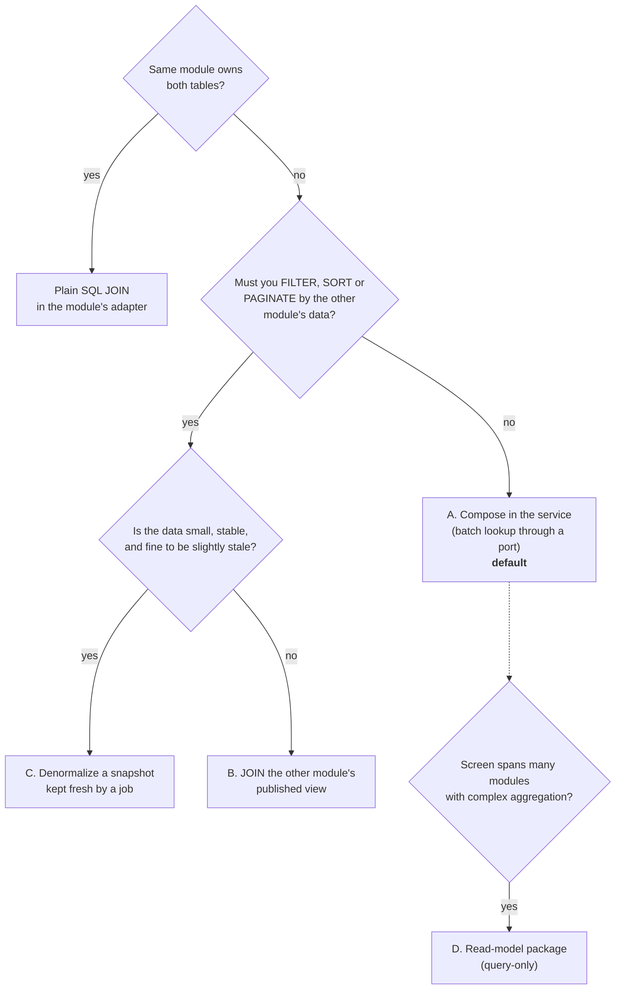
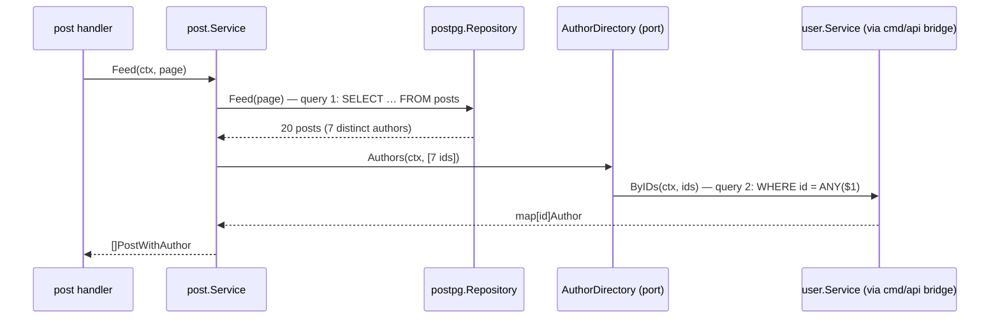
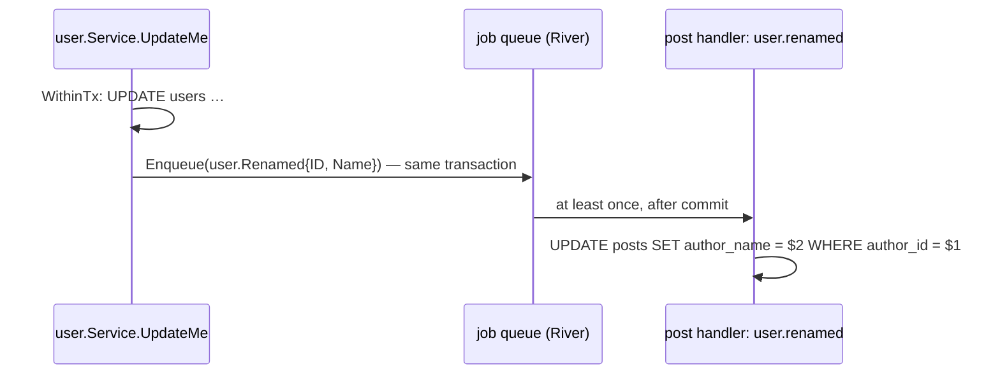

# Reading data across modules ("how do I join?")

You have a `post` module and a `user` module, and an endpoint must return
posts **with their author's name**. In a layered codebase you would write one
`JOIN` and move on. Here, modules own their tables and must not import each
other (ADR-0002), so the obvious `JOIN posts ON users` breaks the rules.

This guide lists the four patterns, when each one fits, and complete code for
each. The decision itself is recorded in [ADR-0021](adr/0021-cross-module-reads.md).

> **First question: is it really another module?** A module owns everything
> that changes together. `posts` and `comments` are probably one module, and
> inside one module you `JOIN` freely in its `<module>pg` adapter. Everything
> below is only about data owned by a **different** module.

---

## Which pattern?



| Pattern | Use when | Cost |
| --- | --- | --- |
| **A. Compose in the service** | You only need to *display* related data for a page of results. **Start here.** | One extra query per request (never per row). |
| **B. Join a published view** | You must filter, sort or paginate *by* the other module's columns (for example "posts whose author name matches q"). | Modules share a database and a view contract; harder to split later. |
| **C. Denormalized snapshot** | Hot read path, small field (a name, an avatar URL), staleness of seconds is fine. | Sync logic: a job updates the copies when the source changes. |
| **D. Read-model package** | Dashboards and reports that aggregate many modules. | One more package, read-only by rule. |

---

## A. Compose in the service (default)

The post service loads a page of posts, collects the distinct author IDs, and
asks a **port it declares itself** for those authors **in one call**. The
composition root bridges that port to the user module.



**Two queries per page, whatever the page size.** The anti-pattern to avoid is
looking authors up inside the loop, which is one query per post (N+1).

### 1. The user module exposes a batch lookup

`internal/user/userpg/queries.sql`:

```sql
-- name: ListUsersByIDs :many
SELECT * FROM users WHERE id = ANY(@ids::uuid[]);
```

`internal/user/user.go`: add to the `Repository` port:

```go
ByIDs(ctx context.Context, ids []uuid.UUID) ([]User, error)
```

`internal/user/userpg/repository.go`:

```go
func (r *Repository) ByIDs(ctx context.Context, ids []uuid.UUID) ([]user.User, error) {
	rows, err := r.q(ctx).ListUsersByIDs(ctx, ids)
	if err != nil {
		return nil, errs.Wrap(errs.Internal, "", err)
	}
	out := make([]user.User, len(rows))
	for i, row := range rows {
		out[i] = toDomain(row)
	}
	return out, nil
}
```

`internal/user/service.go`: like `ByID`, this exists for other modules and
does no authorization:

```go
// ByIDs returns the users that exist among ids, in no particular order.
func (s *Service) ByIDs(ctx context.Context, ids []uuid.UUID) ([]User, error) {
	if len(ids) == 0 {
		return nil, nil
	}
	return s.repo.ByIDs(ctx, ids)
}
```

### 2. The post module declares what it needs, in its own words

`internal/post/post.go`:

```go
// Author is how the post module sees a user: only what it displays.
type Author struct {
	ID   uuid.UUID
	Name string
}

// AuthorDirectory resolves authors in bulk. It returns an entry for every
// ID that exists and silently omits the rest (e.g. deleted users).
type AuthorDirectory interface {
	Authors(ctx context.Context, ids []uuid.UUID) (map[uuid.UUID]Author, error)
}

// PostWithAuthor is the read shape returned by feed-style use cases.
type PostWithAuthor struct {
	Post
	Author Author
}
```

Note that `post` does not import `user`, and it never sees `PasswordHash`,
emails or roles. If the user module changes its internals, `post` doesn't
notice.

### 3. The service composes

`internal/post/service.go`:

```go
// deletedAuthor is shown when an author no longer exists.
var deletedAuthor = Author{Name: "deleted user"}

func (s *Service) Feed(ctx context.Context, req page.Request) (page.Page[PostWithAuthor], error) {
	rows, err := s.repo.Feed(ctx, req) // limit+1 rows, newest first
	if err != nil {
		return page.Page[PostWithAuthor]{}, err
	}
	p := page.Build(rows, req.Limit, func(x Post) page.Cursor {
		return page.Cursor{CreatedAt: x.CreatedAt, ID: x.ID}
	})

	// Collect DISTINCT author IDs: one lookup for the whole page.
	ids := make([]uuid.UUID, 0, len(p.Items))
	seen := make(map[uuid.UUID]bool, len(p.Items))
	for _, x := range p.Items {
		if !seen[x.AuthorID] {
			seen[x.AuthorID] = true
			ids = append(ids, x.AuthorID)
		}
	}
	authors, err := s.authors.Authors(ctx, ids)
	if err != nil {
		return page.Page[PostWithAuthor]{}, err
	}

	out := make([]PostWithAuthor, len(p.Items))
	for i, x := range p.Items {
		a, ok := authors[x.AuthorID]
		if !ok {
			a = deletedAuthor
			a.ID = x.AuthorID
		}
		out[i] = PostWithAuthor{Post: x, Author: a}
	}
	return page.Page[PostWithAuthor]{Items: out, NextCursor: p.NextCursor}, nil
}
```

For a single post (`GET /posts/{id}`) it's the same call with one ID.

### 4. The composition root bridges the two

`cmd/api/adapters.go`, next to the existing `authUsers` bridge:

```go
// postAuthors adapts the user module to post.AuthorDirectory.
type postAuthors struct {
	users *user.Service
}

func (a postAuthors) Authors(ctx context.Context, ids []uuid.UUID) (map[uuid.UUID]post.Author, error) {
	us, err := a.users.ByIDs(ctx, ids)
	if err != nil {
		return nil, err
	}
	out := make(map[uuid.UUID]post.Author, len(us))
	for _, u := range us {
		out[u.ID] = post.Author{ID: u.ID, Name: u.Name}
	}
	return out, nil
}
```

`cmd/api/app.go`:

```go
posts := post.NewModule(post.Deps{
	Repo:    postpg.NewRepository(txm),
	Authors: postAuthors{users: users.Service},
	// ...
}, post.Config{})
```

### Why this is the default

- **Modules stay independent.** If users move to a separate service, only
  `postAuthors` changes, to an HTTP or gRPC client. `post` is untouched.
- **Easy to test.** A fake `AuthorDirectory` is a five-line map.
- **Easy to cache.** Wrap the bridge with `cache.Loader` keyed by user ID, if
  profiling ever shows it's needed.
- **Cheap.** A primary-key `ANY($1)` lookup of 20 IDs is sub-millisecond.

### Where it stops working

Composition happens **after** the page is fetched. It can't express "posts
whose author's name contains *ada*", or "sort posts by author name", because
the database that pages the posts doesn't know about names. For that, use B
or C.

---

## B. JOIN the other module's *published view*

When the query genuinely needs the other module's columns in `WHERE` or
`ORDER BY`, let the database do it, but **through a contract**, not the
other module's private table.

The owning module (user) publishes a view, in its own migration:

```sql
-- +goose Up
-- Published read contract of the user module. Other modules may JOIN this
-- view; they must never query the users table directly. Changing these
-- columns is a breaking change: treat it like an API change.
CREATE VIEW user_profiles AS
SELECT id, name FROM users;

-- +goose Down
DROP VIEW user_profiles;
```

The consuming module (post) joins the **view** in its own adapter.
`sqlc.embed` keeps the generated row type tidy:

```sql
-- name: SearchPostsByAuthorName :many
SELECT sqlc.embed(p), u.name AS author_name
FROM posts p
JOIN user_profiles u ON u.id = p.author_id
WHERE u.name ILIKE sqlc.arg(pattern)::text
ORDER BY p.created_at DESC, p.id DESC
LIMIT sqlc.arg(row_limit);
```

sqlc generates `SearchPostsByAuthorNameRow{Post Post; AuthorName string}`,
which the adapter maps straight to `post.PostWithAuthor`:

```go
for i, row := range rows {
	out[i] = post.PostWithAuthor{
		Post:   toDomain(row.Post),
		Author: post.Author{ID: row.Post.AuthorID, Name: row.AuthorName},
	}
}
```

Rules that keep this safe:

- **Views only, read only.** A module never writes another module's tables,
  and never reads them except through a view that the owner created.
- **The owner decides what's published.** `user_profiles` exposes `id` and
  `name`, never `password_hash` or `email`.
- **Name views after the contract**, not the table (`user_profiles`, not
  `users_v`), and note in the owner's migration who depends on them.
- **Index for the join.** `posts(author_id)` and whatever the filter needs.

Cost: the modules now share one database and a schema contract. Extracting
`user` into its own service later means replacing this view with pattern C.

---

## C. Denormalized snapshot, kept fresh by a job

Copy the few fields you need onto your own table (`posts.author_name`), and
update the copies when the source changes. Reads become a single-table query
that can filter and sort by anything.



- The user module **publishes** the job args type (`user.Renamed`) and
  enqueues it inside its transaction (ADR-0010), so the event can't be lost.
- The post module **handles** it with a plain function. The composition root
  registers it: `riverjobs.Register(queue, posts.Service.HandleUserRenamed)`.
  Because `post` mustn't import `user`, the job type lives in a tiny shared
  package (for example `internal/events`) or is mirrored by kind string.
- The handler must be **idempotent** (setting a name twice is harmless) and
  tolerant of ordering: include an `updated_at` or version, and ignore stale
  updates.
- Backfill existing rows in the migration that adds the column.

Use it for small, slowly changing fields on hot paths. Don't use it for data
that must be exact at the moment of reading, such as permissions or balances.

---

## D. A read-model package for cross-cutting screens

Admin dashboards and reports ("posts per user per month, with last login")
read many modules at once. Instead of teaching every module about every
report, add a **query-only** package, for example `internal/reporting`:

- It may read **published views** of any module (pattern B rules).
- It never writes, and no module imports it; only `cmd/api` mounts its routes.
- Heavy queries can later move to a read replica or a warehouse without
  touching any module.

Add a `depguard` rule so nothing imports it and it imports no module packages.

---

## Checklist for code review

- [ ] Same module? Then a normal `JOIN` is fine. Stop here.
- [ ] Display only? Pattern A, with **one batch call per request**, never
      one per row.
- [ ] Filtering or sorting by foreign data? Pattern B (a view the owner
      published) or C (snapshot).
- [ ] No SQL in one module references another module's **tables**. Views
      only, and only if the owner published them.
- [ ] No module imports another module. Bridges live in `cmd/api/adapters.go`.
- [ ] Missing related rows (deleted users) are handled explicitly.
